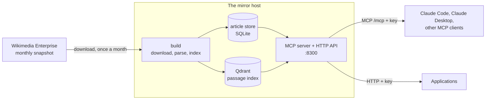

# sfn-wiki-mirror

A local copy of English Wikipedia, searchable and readable by AI agents through an **MCP server**, with a plain
HTTP API for everything else. It is refreshed monthly from Wikimedia Enterprise's snapshots and runs on your own
hardware.

## Why

AI agents that use Wikipedia live run into its API rate limits, its policies for robots, and network latency, and
an agent that fetches pages in a loop hammers a volunteer-run service. This server holds the whole of English
Wikipedia locally. Any MCP-capable agent (Claude Code, Claude Desktop, other MCP clients) can search and read
articles as often and as fast as it likes, with no throttling by Wikipedia, and any other program can do the same
over HTTP. Wikipedia itself is contacted once a month, for one bulk download.

Every search and article reply carries the snapshot date, the revision id and a permalink to the exact revision it
read (`https://en.wikipedia.org/wiki/<Title>?oldid=<revision>`), so an answer can be cited precisely. An article
reply also carries the licence (CC BY-SA 4.0); search replies do not, but the same licence covers them.

### Self-hosted, or an MCP server in front of Wikipedia's API?

Lightweight MCP servers that call Wikipedia's live API already exist, for example
[wikipedia-mcp](https://github.com/Rudra-ravi/wikipedia-mcp), which installs in a minute, covers every language
edition and always returns today's revision. For occasional lookups that is the simpler choice. Its own documentation
notes the trade-off: "Wikipedia API has rate limits; consider adding delays between requests", and it suggests a
personal access token to avoid 403 errors.

Self-hosting is worth its disk space and setup when:

| | Live-API MCP server | This mirror |
|---|---|---|
| Request volume | Bounded by Wikipedia's rate limits; heavy agent loops get throttled | Unbounded: limited only by your hardware |
| Latency | A round trip to Wikipedia per call | About 27 ms per search from the local network, 1-2 ms per article read |
| Load on Wikipedia | Every agent call | One bulk download a month |
| Availability | Needs internet access | Works on an isolated network |
| Privacy | Queries reach a third party | Queries never leave your network |
| Search | Wikipedia's own search | Passage-level keyword search, semantic search next, under your control |
| Reproducible citations | The live revision, which may change | A fixed monthly snapshot and an exact `?oldid=` permalink |
| Freshness and coverage | Live, every language | Up to a month old, English only today |
| Cost | Nothing to host | About 250 GB of local disk plus 300 GB for snapshots, a 32 GB box, and compute for the build ([SIZING](docs/SIZING.md)) |

### Other ways to self-host Wikipedia

Offline Wikipedia is not new; Wikipedia keeps its own
[list of offline readers](https://en.wikipedia.org/wiki/Wikipedia:Database_download#Offline_Wikipedia_readers).
The one to know is [Kiwix](https://www.kiwix.org/): it packs a wiki into a single ZIM file with a built-in full-text
index, and reads it in apps for every platform or serves it over HTTP with `kiwix-serve`.
[openzim-mcp](https://github.com/cameronrye/openzim-mcp) puts an MCP server in front of ZIM files, so an agent
already gets throttle-free, offline Wikipedia from a file and a `uvx` command. Older routes exist too:
[XOWA](https://en.wikipedia.org/wiki/XOWA) builds a desktop reader from the XML dumps (no longer actively
developed), and importing the dumps into your own MediaWiki gives you its full API, but at English Wikipedia's size
that is a project in itself ([WP-MIRROR](https://www.mediawiki.org/wiki/Wp-mirror), which automated it, has been
unsupported since 2014).

If you want Wikipedia on a laptop, a phone or a Raspberry Pi, or for one agent on one machine, Kiwix and openzim-mcp
are far less to run, and they carry images. This project is for a different job: a search service on your network
that several agents and programs share, where finding the right passage matters and so does citing exactly what was
read.

| | Kiwix ZIM (+ openzim-mcp) | This mirror |
|---|---|---|
| What you run | One file and a reader or server; no build step | A service, Qdrant and a monthly build on a server or container |
| Footprint | English ZIM: 13 GB intros only, 49 GB text, 119 GB with images | 62 GB today (store + keyword index); about 160 GB with the semantic index |
| Search | The archive's own full-text index, over whole articles | Ranked keyword search over 41.6M passages; the best passage per article, with its section; semantic search next |
| Updates | Download a new file when Kiwix publishes one; English builds come every few months | A new Wikimedia Enterprise snapshot built monthly while the old index keeps serving (scheduled; the first build was started by hand and the timer's first unattended run is 2026-11-02, so unattended operation is not yet proven) |
| Citations | The article as packed in that file | The revision id and an `?oldid=` permalink to the exact revision, on every search and article reply |
| Sharing | openzim-mcp: stdio, or Streamable HTTP with a bearer token | Streamable HTTP and a REST API, one revocable key per client, request ids in every log line |
| Content | Rendered pages, with images in the large builds | Plain text cut for models, in pageable windows; no images |

ZIM sizes and dates are from [Kiwix's download index](https://download.kiwix.org/zim/wikipedia/) in October 2026
(latest English builds: images 2026-08, text-only 2026-06, intros 2026-09).

## What it does

- **Search:** keyword search over 41.6M passages of 7.2M articles, one result per article, with a snippet and the
  article's title and section. Semantic (embedding) search is designed and next ([ROADMAP](docs/ROADMAP.md)).
- **Read:** the text of any article by title or page id, in windows a model can take, with paging.
- **MCP:** two read-only tools, `wiki_search` and `wiki_read`, over Streamable HTTP at `/mcp`.
- **HTTP:** `POST /v1/wiki/search`, `GET /v1/wiki/article`, `GET /v1/wiki/health`.
- **Keys:** one bearer key per client, stored as a hash, revocable in seconds.
- **No live Wikipedia traffic** at query time; no rate limit applied by this service.

## State (2026-10-19)

Phase names used in these docs: **W2** is the planned semantic (embedding) index and hybrid search; **W3** is the
planned in-place monthly update. Both are defined in [docs/DESIGN.md §7](docs/DESIGN.md#7-phases) and neither is
built.

| | |
|---|---|
| Snapshot served | 2026-10-01 (`enwiki_namespace_0`, English Wikipedia articles only) |
| Articles | 7,245,149 |
| Passages in the keyword index | 41,590,915 |
| Search latency | about 27 ms with the index cached, 241 ms (p50) on first touch; article reads 1 to 2 ms (measured over the API on 2026-10-18) |
| Search mode | keyword (BM25-style sparse vectors in Qdrant); the semantic bge-m3 index is next |
| Updates | A new Wikipedia snapshot is built monthly (scheduled, not yet proven unattended). Code updates are by hand (`wiki-mirror update`), or nightly from `main` with a guard and rollback if you opt in with `--auto-update`. |

**Sizing** (measured unless marked estimate; details and the arithmetic in [docs/SIZING.md](docs/SIZING.md)):

| | |
|---|---|
| Snapshot download | 151 GB compressed, about 45 minutes; about 700 GB of HTML uncompressed (estimate) |
| Article store | 25 GB |
| Keyword index | 37 GB on disk, about 4-5 GB RAM |
| Semantic index (estimate) | about 95 GB on disk, about 10 GB RAM; total local disk about 160 GB, so plan on 250 GB with the headroom a monthly build needs |
| Embedding the corpus (estimate) | about 4.7 exaFLOPs: about 45 h at 29 effective TFLOPS (measured), roughly 1,300 / TFLOPS hours |

What is built and what is not: [docs/ROADMAP.md](docs/ROADMAP.md). The monthly job is currently a full build beside
the live index; in-place monthly updates are designed but not built.

## Connect an agent

```bash
claude mcp add --transport http wikipedia http://<mirror-host>:8300/mcp \
  --header "Authorization: Bearer <key>"
```

Then ask the agent to look something up. Setup for Claude Desktop, other MCP clients and the Python SDK, with
every tool's schema, replies and errors, is in [docs/MCP.md](docs/MCP.md). The same data over HTTP:

```bash
curl -s -X POST http://<mirror-host>:8300/v1/wiki/search \
  -H "Authorization: Bearer $KEY" -H 'Content-Type: application/json' \
  -d '{"query": "photosynthesis chlorophyll", "limit": 3}'
```

Parameters, replies, errors, health semantics and capacity: [docs/API.md](docs/API.md). Keys are issued on the host
with `wiki-mirror key add <name>`.

## Architecture



The build runs as one Unix user with internet access and no listening port; the API runs as another with a
listening port and no internet. Details: [docs/ARCHITECTURE.md](docs/ARCHITECTURE.md).

## Running it

### Before you start

* **A dedicated x86_64 Debian 12 or 13 container or VM.** A Proxmox LXC is the tested path. The installer owns the
  box's nftables firewall, which is default-drop, so do not use a shared host or a Docker host.
* **CPU and RAM:** 6 cores (the parse stage runs 5 workers by default) and 32 GB of RAM advised, 8 GB at the
  least ([docs/SIZING.md](docs/SIZING.md)).
* **Disk:** 250 GB of fast local disk for the article store and the index, plus about 300 GB of bulk storage for the
  two retained snapshots ([docs/SIZING.md](docs/SIZING.md)). On a single disk, plan for about 550 GB.
* **Storage mounted at `/mnt/wikipedia`.** The snapshots go there, and the build refuses to run unless it is a mount
  point: NFS from a NAS, or a directory on a big local disk bind-mounted onto it
  ([docs/OPERATIONS.md](docs/OPERATIONS.md#2-storage-at-mntwikipedia)).
* **A free Wikimedia Enterprise account** at <https://enterprise.wikimedia.com/>; its free tier includes the Snapshot
  API this mirror downloads from ([docs/OPERATIONS.md](docs/OPERATIONS.md#3-the-enterprise-account-and-sign-in)).
* **Time:** about 30 minutes to install, about 151 GB to download, about 14 hours for the first build (measured:
  2026-10-17 to 10-18).

### What is in `deploy/`

`deploy/` holds the installer, the updater, the `wiki-mirror` operator command, systemd units and a default-deny
firewall (a template: your network goes in `/etc/wiki-mirror/site.env`, where `LAN_CIDR` is required and
`EMBEDDING_HOST` and `EMBEDDING_PORT` are optional, see [`deploy/site.env.example`](deploy/site.env.example)).
The installer clones this repository over anonymous HTTPS; no deploy key is needed. The nightly self-update is opt-in:
`install.sh --auto-update` turns it on, and it means your box runs whatever lands on `main` as root; without it, update
by hand with `wiki-mirror update`. Install, operation, the update, memory and disk guidance, uninstalling and failure
recovery: [docs/OPERATIONS.md](docs/OPERATIONS.md).

## Development

Python 3.13 (the host runs 3.13; the tests also run on newer Pythons).

```bash
python3 -m venv .venv
.venv/bin/pip install -e ".[dev]"
.venv/bin/ruff check .
.venv/bin/mypy src tools
.venv/bin/pytest -q
```

The tests need no network, no GPU, no Qdrant and no Enterprise account; all of those are faked. Read
[CONTRIBUTING.md](CONTRIBUTING.md) before changing anything (coding agents: [CLAUDE.md](CLAUDE.md)). Two points
matter most:

* The passage chunker and keyword encoder (`src/wiki_mirror/text/`) must stay byte-identical, or the
  41.6M-passage index no longer matches the code.
* **`main` is deployed to every box that has the nightly update enabled.** Do not push untested work to it.

| Path | Holds |
|---|---|
| `src/wiki_mirror/` | The service: Enterprise client, parser, article store, indexer, search, API, MCP server, CLI |
| `tools/` | The golden-set generator and the passage-length evaluation |
| `deploy/` | Installer, updater, `wiki-mirror`, systemd units, nftables, Qdrant and service config templates |
| `tests/` | Mirrors the above; faked dependencies in `tests/fixtures/` |
| `docs/` | Everything below |

## Documentation

| File | For | Contents |
|---|---|---|
| [docs/MCP.md](docs/MCP.md) | Agent and MCP client users | Transport, auth, the two tools with schemas, examples and errors, client setup (Claude Code, Claude Desktop, Python) |
| [docs/API.md](docs/API.md) | Client authors | HTTP endpoints, request ids, replies, errors, health, keys, limits and logging, performance, citation |
| [docs/OPERATIONS.md](docs/OPERATIONS.md) | Whoever runs the host | Install, `wiki-mirror`, builds, nightly update and its guards, memory and disk, failure modes |
| [docs/SIZING.md](docs/SIZING.md) | Anyone planning hardware | Data and store sizes, memory, and the embedding compute arithmetic (measured and estimated) |
| [docs/ARCHITECTURE.md](docs/ARCHITECTURE.md) | Engineers | Components, data layout, the two-collection index, security posture |
| [docs/DESIGN.md](docs/DESIGN.md) | Maintainers | The design, with the measurements behind each choice |
| [docs/DECISIONS.md](docs/DECISIONS.md) | Maintainers | The dated decision log (D1 onward) |
| [docs/EVALUATION.md](docs/EVALUATION.md) | Whoever changes search | The golden set, the passage-length evaluation and its results, embedding rates, how to rerun |
| [docs/ROADMAP.md](docs/ROADMAP.md) | Planning | Article annotations (links, references, infoboxes, tables) and a web reader, the semantic build, monthly in-place updates |
| [CONTRIBUTING.md](CONTRIBUTING.md) | Contributors | The constraints that bind a change, setup, tests, linters |
| [SECURITY.md](SECURITY.md) | Anyone who finds a vulnerability | How to report one privately, and what is in scope |
| [CHANGELOG.md](CHANGELOG.md) | Everyone | What each release contains |
| [CLAUDE.md](CLAUDE.md) | Coding agents | Conventions, constraints and the verification commands |

## Licence and attribution

The code is MIT-licensed (see [LICENSE](LICENSE)). Wikipedia text is licensed CC BY-SA 4.0. Search and article
replies carry the snapshot date and a permanent revision link, and article replies carry the licence, so that quoted
text can be attributed. This repository is code and documentation, with one exception: two test fixtures hold
Wikipedia content under CC BY-SA 4.0, attributed to Wikipedia contributors. `tests/fixtures/wme/records.ndjson` is
eight whole English Wikipedia articles, and `tests/fixtures/vendored_golden.json` holds text derived from them.
[NOTICE](NOTICE) states this; each article's page history is at the `url` in its record. Clone from
`https://github.com/SFN-ALPHA/sfn-wiki-mirror`.
