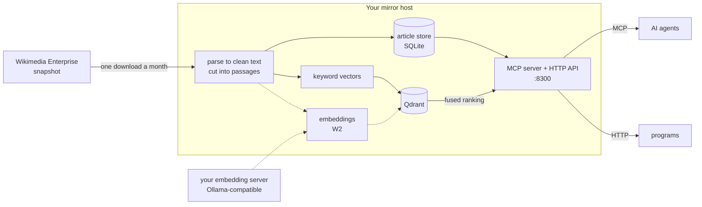

# sfn-wiki-mirror

**Hybrid keyword and semantic search over your own copy of English Wikipedia, served to AI agents through MCP.**

sfn-wiki-mirror turns Wikimedia's snapshots of English Wikipedia into a search service on your own network. Each
month it downloads the latest snapshot, reduces every article to clean text, cuts the text into passages and
generates the search indexes automatically: a keyword index and a semantic (embedding) index, fused into one
ranking. Any MCP-capable agent can then search and read all of Wikipedia locally, as often as it likes, and cite
the exact revision it read.

> **Status, October 2026.** Keyword search is live over 41.6 million passages from 7.2 million articles. The semantic
> index is built, and `semantic` and `hybrid` search are available as opt-in modes (`mode` in the search request,
> [docs/API.md](docs/API.md#post-v1wikisearch)); keyword stays the default until the golden set and the
> fusion-weight check pass ([roadmap](docs/ROADMAP.md), phase W2).

## What sets it apart

- **Search built for agents.** Articles are cut into passages of about 720 characters. A query returns the best
  passage from each matching article, with its title, section and snippet: what a model needs to decide what to
  read, rather than a list of page titles.
- **Hybrid retrieval.** Keyword search (BM25-style sparse vectors) finds exact names, numbers and rare terms.
  Semantic search (bge-m3 embeddings) finds passages that answer a question in other words. Both indexes live in
  Qdrant and are fused with reciprocal rank fusion. A search asks for `lexical` (the default), `semantic` or `hybrid`,
  and every mode returns the same result shape. *The default stays keyword until the golden set passes.*
- **A fully automated pipeline.** One monthly job downloads the snapshot, parses it, builds the article store and
  generates the keyword vectors; from W2 it also generates embeddings on an Ollama-compatible server you point it at.
  The new index is built beside the live one, so search keeps serving throughout.
- **An MCP layer, and plain HTTP.** Two read-only tools, `wiki_search` and `wiki_read`, over Streamable HTTP, and the
  same data through a REST API. Each client gets its own revocable key.
- **Exact citations.** Every reply carries the snapshot date, the revision id and an `?oldid=` permalink to the
  revision that was read.
- **Local and fast.** About 27 ms per search and 1-2 ms per article read on the local network, with no rate limit.
  Wikipedia is contacted once a month, for one bulk download, and queries never leave your network.
- **Secure by default.** The builder and the server run as separate users: the builder can reach the internet but
  listens on no port; the server listens but cannot reach the internet (its one outbound connection is the embedding of
  a semantic question, to your embedding server only). The box has a default-deny firewall, the
  Python and Qdrant builds are pinned by hash, and the updater rolls itself back if a new version starts unhealthy.

## How it works



1. **Download.** On the 2nd of each month the build fetches the English Wikipedia snapshot (151 GB compressed) from
   Wikimedia Enterprise's Snapshot API, which its free tier includes.
2. **Parse.** Each article's HTML is reduced to plain text, section by section, and stored in a SQLite article store.
3. **Cut.** The sections are cut into passages: 41.6 million of them for 7.2 million articles.
4. **Index.** Each passage gets a keyword vector and, from W2, an embedding. Both are stored in Qdrant, in a new
   collection built beside the one being served.
5. **Serve.** A search queries the keyword index (or, in `semantic` or `hybrid` mode, the semantic index or both,
   fusing their rankings), keeps the best passage per article and returns it with its section and citation. `wiki_read` then pages through the full article in windows a model can take.

Details: [docs/ARCHITECTURE.md](docs/ARCHITECTURE.md), and the measurements behind each choice in
[docs/DESIGN.md](docs/DESIGN.md).

## Connect an agent

```bash
claude mcp add --transport http wikipedia http://<mirror-host>:8300/mcp \
  --header "Authorization: Bearer <key>"
```

Then ask the agent to look something up. Setup for Claude Desktop, other MCP clients and the Python SDK, with every
tool's schema, replies and errors, is in [docs/MCP.md](docs/MCP.md). The same data over HTTP:

```bash
curl -s -X POST http://<mirror-host>:8300/v1/wiki/search \
  -H "Authorization: Bearer $KEY" -H 'Content-Type: application/json' \
  -d '{"query": "photosynthesis chlorophyll", "limit": 3}'
```

Parameters, replies, errors, health semantics and capacity: [docs/API.md](docs/API.md). Keys are issued on the host
with `wiki-mirror key add <name>`.

## How it compares

| | Live-API MCP servers | Kiwix ZIM + openzim-mcp | sfn-wiki-mirror |
|---|---|---|---|
| Search | Wikipedia's own search | The archive's full-text index, over whole articles | Ranked passages, best one per article; hybrid semantic next |
| Volume | Bounded by Wikipedia's rate limits | Your hardware | Your hardware, shared by every client on the network |
| Latency | A round trip to Wikipedia per call | Local | About 27 ms per search, 1-2 ms per read |
| Privacy | Queries reach a third party | Local | Local |
| Freshness | Live, every language | A new file when Kiwix publishes one (English: every few months) | Rebuilt monthly; English only today |
| Citations | Today's revision, which may change | The article as packed in that file | Revision id and `?oldid=` permalink on every reply |
| Content | Article text | Rendered pages, with images in the large builds | Plain text for models; no images |
| Footprint | None | One file: 13 GB (intros) to 119 GB (with images) | 62 GB with the keyword index, about 165 GB with the semantic index |
| Setup | A minute | A file and a command | A dedicated container, a free Enterprise account, a 14-hour first build |

For occasional lookups, a live-API server such as [wikipedia-mcp](https://github.com/Rudra-ravi/wikipedia-mcp) is
simpler and covers every language. For Wikipedia on a laptop, a phone or one machine,
[Kiwix](https://www.kiwix.org/) with [openzim-mcp](https://github.com/cameronrye/openzim-mcp) is far less to run and
carries images; Wikipedia keeps a fuller
[list of offline readers](https://en.wikipedia.org/wiki/Wikipedia:Database_download#Offline_Wikipedia_readers).
This project is for a different job: a search service that several agents and programs share, where finding the right
passage matters and so does citing exactly what was read.

ZIM sizes are from [Kiwix's download index](https://download.kiwix.org/zim/wikipedia/) in October 2026.

## Status (2026-10-23)

Phase names used in these docs: **W2** is the semantic index and hybrid search; **W3** is the in-place monthly
update. Both are defined in [docs/DESIGN.md §7](docs/DESIGN.md#7-phases). The embedding run of W2 is built; hybrid
search and W3 are not.

| | |
|---|---|
| Snapshot served | 2026-10-01 (`enwiki_namespace_0`, English Wikipedia articles only) |
| Articles | 7,245,149 |
| Passages in the keyword index | 41,590,915 |
| Search mode | Keyword (BM25-style sparse vectors in Qdrant). The embedding run for the semantic index (bge-m3) is built and resumable, and its first full run finished on 2026-10-22; Qdrant is rebuilding the search graphs on disk, and hybrid search over it is next (W2) |
| Latency | About 27 ms per search with the index cached, 241 ms (p50) on first touch; article reads 1-2 ms (measured over the API, 2026-10-18) |
| Disk and memory | Article store 25 GB; keyword index 37 GB on disk and 4-5 GB of RAM; semantic index about 102 GB, all on disk, so 7.4-7.5 GB of pinned RAM for Qdrant in all (measured), with the rest of the 32 GB as page cache (Qdrant's cap is 24G, which also bounds its cache). Semantic search measures about 45 ms cached and about half a second the first time |
| Embedding the corpus | About 45 hours at 29 effective TFLOPS (estimate from measured rates) |
| Updates | A new snapshot is built monthly beside the live index (scheduled; the first unattended run is 2026-11-02, so that is not yet proven). Code updates are by hand (`wiki-mirror update`), or nightly with a guard and rollback if you opt in with `--auto-update`. |

Every figure, measured or estimated, with its arithmetic: [docs/SIZING.md](docs/SIZING.md). What is built and what is
planned, including article annotations (links, references, infoboxes, tables) and a web reader:
[docs/ROADMAP.md](docs/ROADMAP.md).

## Running it

### Before you start

* **A dedicated x86_64 Debian 12 or 13 container or VM.** A Proxmox LXC is the tested path. The installer owns the
  box's nftables firewall, which is default-drop, so do not use a shared host or a Docker host.
* **CPU and RAM:** 6 cores (the parse stage runs 5 workers by default) and 32 GB of RAM advised, 8 GB at the least.
* **Disk:** 250 GB of fast local disk for the article store and the indexes, plus about 300 GB of bulk storage for
  the two retained snapshots. On a single disk, plan for about 550 GB.
* **Storage mounted at `/mnt/wikipedia`.** The snapshots go there, and the build refuses to run unless it is a mount
  point: NFS from a NAS, or a directory on a big local disk bind-mounted onto it
  ([docs/OPERATIONS.md](docs/OPERATIONS.md#2-storage-at-mntwikipedia)).
* **A free Wikimedia Enterprise account** at <https://enterprise.wikimedia.com/>; its free tier includes the Snapshot
  API this mirror downloads from ([docs/OPERATIONS.md](docs/OPERATIONS.md#3-the-enterprise-account-and-sign-in)).
* **For the semantic index (W2, optional today):** an Ollama node with a GPU, on the network or on this box, or an
  Ollama-compatible cluster behind one URL, and the 32 GB of RAM above. Setup for each:
  [docs/OPERATIONS.md](docs/OPERATIONS.md#the-embedding-server).
* **Time:** about 30 minutes to install, about 151 GB to download, about 14 hours for the first build (measured:
  2026-10-17 to 10-18).

### What is in `deploy/`

`deploy/` holds the installer, the updater, the `wiki-mirror` operator command, systemd units and a default-deny
firewall (a template: your network goes in `/etc/wiki-mirror/site.env`, where `LAN_CIDR` is required and
`EMBEDDING_HOST` and `EMBEDDING_PORT` are optional, see [`deploy/site.env.example`](deploy/site.env.example)).
The installer clones this repository over anonymous HTTPS; no deploy key is needed. The nightly self-update is opt-in:
`install.sh --auto-update` turns it on, and it means your box runs whatever lands on `main` as root; without it, update
by hand with `wiki-mirror update`. A maintenance job (`wiki-mirror-maintain.timer`, every 15 minutes) resumes a
Qdrant collection left paused after a restart and records what it saw for `wiki-mirror status` and the health route;
the installer enables it, and a box that updates itself enables it once with `systemctl enable --now
wiki-mirror-maintain.timer`. Install, operation, the update, memory and disk guidance, uninstalling and failure
recovery: [docs/OPERATIONS.md](docs/OPERATIONS.md).

### The semantic index (embedding run)

`wiki-mirror embed-now` (as root) embeds every passage through your embedding server into a second Qdrant collection,
`wikipedia_semantic_<born>`, and `wiki-mirror logs embed` follows it with a progress line each minute: articles,
passages, passages per second and the time left. It takes about two days. It needs a finished keyword build,
`embedding_url` in `mirror.yaml`, the embedding pair in `site.env` so the firewall admits the server, and a 32 GB box.
The index (vectors, binary copy and search graph) is kept on disk and cached by the kernel in spare RAM, so Qdrant's
pinned memory stays small; its memory cap is to be set from the measured figure after the rebuild. The API's
`semantic` and `hybrid` search modes read the collection once the run is complete and the index is of the snapshot
being served (after each monthly build they answer `503 semantic_unavailable` until the semantic catch-up). Each
such search sends the question to your embedding server, which the API holds its own key for
(`EMBEDDING_API_KEY` in its `mirror.env`) and is allowed to reach by the firewall's embedding pair.

The run is built to be interrupted. It works through the articles in order, in windows of 64, and moves a checkpoint
only after Qdrant has confirmed a window. After a crash, a server error, a stop or a reboot, `embed-now` resumes: it
checks the settings, then checks the checkpoint against what Qdrant holds, steps back if a power loss cost Qdrant
its latest writes, and repeats at most the windows that were in flight. A failed run is retried by systemd every 15
minutes, six starts a day. A reboot does not restart it by itself. The run holds the build lock, so the monthly build
and the nightly update wait for it. After a monthly rebuild, a new run starts a full new collection (about 85 GB, about
two days); an update that embeds only changed articles is not built.

The steps, the table of what each interruption does, and the failure modes:
[docs/OPERATIONS.md](docs/OPERATIONS.md#the-semantic-index-w2-the-first-embedding-run).

## Development

Python 3.13 (the host runs 3.13; the tests also run on newer Pythons).

```bash
python3 -m venv .venv
.venv/bin/pip install -e ".[dev]"
.venv/bin/ruff check .
.venv/bin/mypy src tools
.venv/bin/pytest -q
```

The tests need no network, no GPU, no Qdrant and no Enterprise account; all of those are faked. Read
[CONTRIBUTING.md](CONTRIBUTING.md) before changing anything (coding agents: [CLAUDE.md](CLAUDE.md)). Two points
matter most:

* The passage chunker and keyword encoder (`src/wiki_mirror/text/`) must stay byte-identical, or the
  41.6M-passage index no longer matches the code.
* **`main` is deployed to every box that has the nightly update enabled.** Do not push untested work to it.

| Path | Holds |
|---|---|
| `src/wiki_mirror/` | The service: Enterprise client, parser, article store, indexer, search, API, MCP server, CLI |
| `tools/` | The golden-set generator and the passage-length evaluation |
| `deploy/` | Installer, updater, `wiki-mirror`, systemd units, nftables, Qdrant and service config templates |
| `tests/` | Mirrors the above; faked dependencies in `tests/fixtures/` |
| `docs/` | Everything below |

## Documentation

| File | For | Contents |
|---|---|---|
| [docs/MCP.md](docs/MCP.md) | Agent and MCP client users | Transport, auth, the two tools with schemas, examples and errors, client setup (Claude Code, Claude Desktop, Python) |
| [docs/API.md](docs/API.md) | Client authors | HTTP endpoints, request ids, replies, errors, health, keys, limits and logging, performance, citation |
| [docs/OPERATIONS.md](docs/OPERATIONS.md) | Whoever runs the host | Install, `wiki-mirror`, builds, nightly update and its guards, memory and disk, failure modes |
| [docs/SIZING.md](docs/SIZING.md) | Anyone planning hardware | Data and store sizes, memory, and the embedding compute arithmetic (measured and estimated) |
| [docs/ARCHITECTURE.md](docs/ARCHITECTURE.md) | Engineers | Components, data layout, the two-collection index, security posture |
| [docs/DESIGN.md](docs/DESIGN.md) | Maintainers | The design, with the measurements behind each choice |
| [docs/DECISIONS.md](docs/DECISIONS.md) | Maintainers | The dated decision log (D1 onward) |
| [docs/EVALUATION.md](docs/EVALUATION.md) | Whoever changes search | The golden set, the passage-length evaluation and its results, embedding rates, how to rerun |
| [docs/ROADMAP.md](docs/ROADMAP.md) | Planning | Article annotations (links, references, infoboxes, tables) and a web reader, the semantic build, monthly in-place updates |
| [CONTRIBUTING.md](CONTRIBUTING.md) | Contributors | The constraints that bind a change, setup, tests, linters |
| [SECURITY.md](SECURITY.md) | Anyone who finds a vulnerability | How to report one privately, and what is in scope |
| [CHANGELOG.md](CHANGELOG.md) | Everyone | What each release contains |
| [CLAUDE.md](CLAUDE.md) | Coding agents | Conventions, constraints and the verification commands |

## Licence and attribution

The code is MIT-licensed (see [LICENSE](LICENSE)). Wikipedia text is licensed CC BY-SA 4.0. Search and article
replies carry the snapshot date and a permanent revision link, and article replies carry the licence, so that quoted
text can be attributed. This repository is code and documentation, with one exception: two test fixtures hold
Wikipedia content under CC BY-SA 4.0, attributed to Wikipedia contributors. `tests/fixtures/wme/records.ndjson` is
eight whole English Wikipedia articles, and `tests/fixtures/vendored_golden.json` holds text derived from them.
[NOTICE](NOTICE) states this; each article's page history is at the `url` in its record. Clone from
`https://github.com/SFN-ALPHA/sfn-wiki-mirror`.
