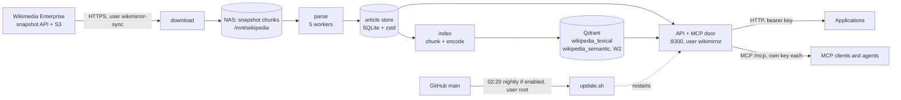

# Architecture

**Audience:** engineers changing the code. This is the map; [DESIGN.md](DESIGN.md) holds the reasoning and the
measurements, and each section below says which part of it to read for depth. Where the two differ, this file
follows the code.

## Overview

One LXC (hostname `wikipedia-mirror`) does everything. Two groups of processes share it and are
kept apart by Unix user, not by address:

* **The build** (user `wikimirror-sync`) runs once a month. It has HTTPS to the internet and no listening port. It
  downloads Wikimedia Enterprise's snapshot, parses it into a SQLite article store and loads a keyword index
  into Qdrant.
* **The service** (user `wikimirror`) runs all the time. It has no internet and listens on :8300 for the LAN. It
  reads the store and queries Qdrant, which listens on loopback only.

## Components

| Component | Code | What it does |
|---|---|---|
| Enterprise download | `enterprise.py`, `build.run_download` | Signs in (token refresh), lists the snapshot's 435 chunks, downloads them 4 at a time to the NAS with resume, and keeps a monthly download counter (`state/enterprise_budget.json`, 1,200 by default against the free tier's 1,500). |
| Parse | `parse.py`, `build.run_parse` | Turns each chunk's Parsoid HTML into plain text with section headings, infobox key-value blocks and category lists; drops reference lists, navigation boxes and "See also" link farms. Workers are spawned processes, one chunk each, streaming to a zstd spool; the parent is the single SQLite writer. |
| Article store | `store.py`, `records.py` | One SQLite file per snapshot, `articles/<identifier>_<yyyymmdd>.db`. Compressed text, title and redirect-alias indexes, a per-article `text_hash`. Highest revision wins on duplicates. A finished store is immutable and opened read-only. |
| Keyword index | `index.py`, `passages.py` | Cuts every article into passages with the vendored chunker and encodes each with the vendored hashed-BM25 sparse encoder, then upserts them into Qdrant. Checkpointed; ends by pointing the alias at the new collection. |
| Semantic index (embedding run) | `embed.py` | Cuts the same passages as the keyword index, asks an Ollama-compatible embedding server for a vector each, and upserts them into `wikipedia_semantic_<born>` in windows of 64 articles with a checkpoint (`state/index_semantic_<born>.json`). Resumable, and a resume verifies the checkpoint against Qdrant. Started by hand (`wiki-mirror embed-now`) as `wiki-mirror-embed.service`. The API's `semantic` and `hybrid` search modes read the result ([D10](DECISIONS.md#d10)). The collection's layout (graph and binary copy on disk, optimizer threads, segment size cap) is the constants `SEMANTIC_HNSW`, `SEMANTIC_QUANTIZATION`, `SEMANTIC_OPTIMIZATION_THREADS` ([D8](DECISIONS.md#d8)) and `SEMANTIC_MAX_SEGMENT_KB` ([D9](DECISIONS.md#d9)). |
| Maintenance job | `maintain.py`, `maintenance_record.py`, `wiki-mirror-maintain.{service,timer}` | Every 15 minutes, as `wikimirror-sync`: reads Qdrant's systemd unit and memory, resumes a paused (`grey`) mirror collection, keeps the semantic collection's live settings equal to the constants in `embed.py`, and writes `state/maintenance.json` for health and `wiki-mirror status`. |
| Serving | `serving.py` | Holds the (collection, store) pair currently served, follows the alias and the index state, and hands requests a lease so a swap never closes a store under a reader. It also pairs the semantic index with the served store (usable only for the same snapshot) and keeps the plain reason when it is not. |
| Search | `search.py` | The three search modes (`lexical`, `semantic`, `hybrid`) behind one result shape: query encoding, passage ranking from one or both collections, reciprocal rank fusion keyed on (point id, `text_hash`), article folding, exact-title priority, snippets cut from the store, windowed article reads. |
| Query embedding | `query_embed.py` | A synchronous client that embeds one question through the embedding server, with the model and vector length the semantic index recorded in its state. One typed error, no retries, a 3 s connect and 15 s read timeout, one shared HTTP client, at most four embeddings at once and a 30 s pause after three unanswered calls in a row, the API's own key from `EMBEDDING_API_KEY`. |
| API and MCP door | `api.py`, `mcp_server.py`, `keys.py` | FastAPI app with a pure-ASGI guard in front: authentication, request ids, JSON errors. `/mcp` is the MCP SDK's Streamable HTTP endpoint behind the same guard. |
| CLI | `__main__.py`, `deploy/wiki-mirror` | `python -m wiki_mirror <download|parse|index|build|embed|maintain|serve|status|key>`; `wiki-mirror` is the operator wrapper. |
| Update path | `deploy/update.sh`, `update_record.py` | Self-update from `main` (nightly, if the operator opted in) with a format guard and rollback; writes `state/update.json`. |

DESIGN.md sections: the article store and index in [§5](DESIGN.md#5-the-design), the Enterprise snapshot in
[§2](DESIGN.md#2-what-wikimedia-publishes-checked-2026-10-16) and [§11](DESIGN.md#11-w0-what-the-box-and-the-account-turned-out-to-be-2026-10-16).

### The build, stage by stage

`python -m wiki_mirror build` is `download`, then `parse`, then `index`. Each stage is a separate
command too, for resuming a failed one by hand.

* **One build at a time.** All stages hold a non-blocking `flock` on `state/build.lock`. A second build exits 1
  with "a build is already running" and changes nothing. The nightly update takes the same lock.
* **Checkpointed.** A download resumes from its `.part` file, a parse skips chunks the store already holds, the
  index resumes after the last page id fully loaded (`state/index_lexical_<born>.json`).
* **Failure shows.** Any exception ends with `phase="failed"` and a short, secret-free error in
  `state/build.json`, which health and `wiki-mirror status` read.
* **A damaged chunk is deleted**, with its `.etag`, so the next run downloads it again.
* **Disk floor.** Before creating a store or a collection, the build checks free space against
  `min_free_disk_gb` (20).
* **Cleanup.** After the alias swap, article stores and index states older than the serving snapshot and the one
  kept as the way back are deleted, and so are Qdrant's superseded collections.

### The embedding run

`python -m wiki_mirror embed`, run as `wiki-mirror-embed.service` (user `wikimirror-sync`, started by `wiki-mirror
embed-now`, never enabled and with no timer, so a reboot does not restart it). It reads the store the live keyword
collection serves, writes `wikipedia_semantic_<born>` and `state/index_semantic_<born>.json`, and at the end switches
HNSW on and moves the alias `wikipedia_semantic`. It is not part of `build`.

* **Same lock, same discipline.** It holds `state/build.lock`, so a build or the nightly update waits. It never
  writes `build.json`, so a failing embedding run does not turn health `degraded`.
* **The checkpoint rule.** Windows are upserted in page-id order; `last_page_id` moves only after Qdrant confirms the
  upsert, and the state file is written atomically. Every article at or below it is fully in Qdrant.
* **A resume is checked twice:** the recorded chunker, model, dimensions and text form against the running ones, and
  the number of points at or below the checkpoint against the state's count. A mismatch (a lost write-ahead log tail
  after a power loss) steps the checkpoint back and rewrites the state before embedding resumes.
* **No state, no deletion.** A collection without a usable state file is refused, never deleted. A state file
  without its collection starts over.
* **Not built:** catching up after a monthly rebuild by embedding only changed articles (W3). Hybrid search is
  built, but is not the default (see "Search modes" below).

The operator's view is in [OPERATIONS.md](OPERATIONS.md#the-semantic-index-w2-the-first-embedding-run); the design in
[DESIGN.md §12.5](DESIGN.md#125-first-semantic-build-w2).

### The maintenance job

`python -m wiki_mirror maintain`, run every 15 minutes by `wiki-mirror-maintain.timer` as the oneshot
`wiki-mirror-maintain.service` (user `wikimirror-sync`, `MemoryMax=256M`, ordered after Qdrant but not requiring it,
no `Restart=`: the timer is the retry). It was added with [D8](DECISIONS.md#d8), after Qdrant was restarted from an
out-of-memory kill and its semantic collection sat paused unnoticed.

* **What a run does.** Reads the previous record and Qdrant's unit (`systemctl show`, and `anon` and `max` from the
  unit's cgroup `memory.stat` and `memory.max`); lists the `wikipedia_lexical_*` and `wikipedia_semantic_*`
  collections; resumes any that is `grey` with an empty optimizers update; reconciles the collection behind the
  `wikipedia_semantic` alias to `embed`'s constants, sending only what differs; writes the record.
* **The record.** `state/maintenance.json` (`maintenance_record.py`, schema 1), written atomically, group-readable.
  Reading never fails and never guesses: a missing, malformed or other-schema file reads as no record. Health returns
  it as `maintenance` and turns `degraded` when it is more than 60 minutes old, when Qdrant was restarted after a
  failure within 24 hours, or when Qdrant's anonymous memory is above 90% of its cap.
* **Settings wait for a safe moment.** A graph or binary-copy placement change makes Qdrant rebuild every segment's
  graph, and a change of the segment size cap ([D9](DECISIONS.md#d9)) makes it merge and rewrite them, so either is
  sent only when the collection's embedding run is complete, the collection is not `red`, the build lock is free
  (probed, never held) and the disk has its floor plus the room the merges need. Otherwise the record's problems say
  what it waits for.
* **The code is the truth** for the semantic settings: a hand change is put back on the next run.
* **It never stops the record.** A source it cannot read becomes an empty field and a problem sentence; exit 1 only
  when the record cannot be written. It starts no embedding run, build or update.

The operator's view is in [OPERATIONS.md](OPERATIONS.md#the-maintenance-job); the design in
[DESIGN.md §12.5](DESIGN.md#125-first-semantic-build-w2).

## Data layout

Paths are inside the container. The defaults are in `config.py` and can be changed in `mirror.yaml`.

| Path | Holds | Disk | Backed up |
|---|---|---|---|
| `/mnt/wikipedia/snapshots/<identifier>_<yyyymmdd>/` | Downloaded Enterprise chunks (`.tar.gz`, about 151 GB), `.etag` sidecars, `snapshot.json`. Two kept (`retain_snapshots`). | Bulk storage mounted at `/mnt/wikipedia` (NFS from a NAS, bind-mounted by the Proxmox host, or a bind-mounted local directory) | No: re-downloadable |
| `/var/lib/wiki-mirror/articles/<identifier>_<yyyymmdd>.db` | The article store, 25 GB for the 2026-10-01 snapshot | Local (NVMe) | No: rebuildable from the snapshot |
| `/var/lib/wiki-mirror/qdrant/` | Qdrant storage (37 GB for the keyword index) | Local | No: rebuildable |
| `/var/lib/wiki-mirror/state/` | `build.json`, `build.lock`, `index_lexical_<born>.json` (index state and checkpoint), `index_semantic_<born>.json` (the embedding run's state and checkpoint), `enterprise_budget.json`, `update.json`, `maintenance.json` (the maintenance job's last record) | Local | Should be: losing an index state file takes search down until it is restored (DESIGN.md §12.8) |
| `/var/lib/wiki-mirror/tmp/` | The parse spool | Local | No |
| `/etc/wiki-mirror/` | `mirror.yaml`, `mirror.env` (the primary key), `enterprise.env` (Enterprise sign-in), `clients.json` (key hashes), `qdrant.yaml` | Local | Config only; never in git |
| `/opt/wiki-mirror/` | The git checkout and its venv, root-owned | Local | No |

The article store and Qdrant must stay on local disk, never on the NAS: SQLite locking and Qdrant's memory-mapped
files both misbehave on network filesystems. The NAS holds only the downloaded snapshots, which are read
sequentially once per build.

### The article store

Table `articles`: `page_id` (primary key), `title`, `title_fold`, `revision_id`, `revision_time`, `categories`,
`is_disambiguation`, `license`, `abstract`, `text` (zstd), `chars`, `text_hash` (first 8 bytes of the SHA-256 of
the plain text). Table `redirects` maps folded aliases to page ids, so "Einstein" finds "Albert Einstein". `meta`
holds the snapshot description, the schema version (2) and `parser_version`. The 2026-10-01 snapshot has
7,245,149 articles and 30.0 billion characters of text.

## The index: two collections, shared point ids

The keyword index is a Qdrant collection `wikipedia_lexical_<born>`, where `<born>` is the date of the snapshot
it was first built from, behind the alias `wikipedia_lexical`. The semantic index (W2) is a second collection,
`wikipedia_semantic_<born>`, behind `wikipedia_semantic`, which the `semantic` and `hybrid` search modes read. Reasons for two collections
rather than one with both vectors are in [DESIGN.md §12.2](DESIGN.md#122-the-four-decisions-in-this-plan).

* **Point id** = `page_id * 10000 + chunk`, the same in both collections (`records.passage_point_id`). Re-running
  over an article overwrites its own points, which is what makes resume and in-place updates safe.
* **Payload** has no text: `page_id`, `revision_id`, `chunk`, `section`, `disambiguation`, `text_hash`. The store
  serves the text, which keeps the index tens of GB smaller. A snippet is made by re-cutting the stored article
  with the same chunker and taking chunk `n`, so the index and the store must describe the same text.
* **Vectors.** The keyword collection has one sparse vector, `lexical`, 2^24 hashed dimensions, with Qdrant's IDF
  modifier. The semantic collection holds bge-m3 vectors (1,024 dimensions, cosine), float16 on disk with
  a binary-quantized copy and rescoring ([D1](DECISIONS.md#d1), [D5](DECISIONS.md#d5)); the copy and the HNSW graph
  are on disk too, not pinned in RAM ([D8](DECISIONS.md#d8)). Its `born` is the tag of
  the store it was embedded from, and its on-disk integer payload index on `page_id` serves both the resume check and
  W3's per-article selection.
* **Segments are capped** at 400,000 KB with one optimization at a time, so a merge fits in memory and a rewrite
  never needs a third of the disk free. Both came from OOM kills during the first build (DESIGN.md §12.8). (The
  semantic collection has its own: 10 GB segments, `SEMANTIC_MAX_SEGMENT_KB`, and two optimizations at a time,
  [D9](DECISIONS.md#d9) and DESIGN.md §12.5.)
* **The index state file** `state/index_lexical_<born>.json` records the build checkpoint, the chunker
  fingerprint (`v1:512/50`) and `applied_snapshot`: the snapshot whose store the passages were cut from. Serving
  pairs the collection with that snapshot's store. Today `applied_snapshot` equals `<born>`; the planned monthly
  in-place update (W3, [ROADMAP.md](ROADMAP.md)) will move it without moving the alias.
* **The semantic state file** `state/index_semantic_<born>.json` records the embedding run's checkpoint
  (`last_page_id`, with the article and passage counts), what the vectors are made of (chunker fingerprint, model,
  dimensions, text form), whether the run is `complete`, and `applied_snapshot` once it is. A resume refuses to go on
  if the settings differ, and checks the passage count against Qdrant.

### Serving follows the data

`serving.ServedSnapshot` re-checks every 30 seconds where the alias points and what the index state says it
reflects, and opens the matching store read-only. A request holds a lease on one (collection, store) pair for its
whole life, so a swap in the middle of a request is harmless and the old store is closed when its last lease
ends. No restart is needed after a build. If the new store cannot be opened, or the collection has no usable
index state, the old pair keeps serving and health says `degraded`.

A search never mixes snapshots. It queries the concrete collection it was paired with, not the alias, and drops
a hit whose `text_hash` differs from the stored article's (logged with the page id only).

The semantic index is paired with the served store in the same looks, and never raises. It is usable only when its
alias exists, its state is readable and `complete`, its `applied_snapshot` is the served store's, it was cut by this
code's chunker and `embedding_url` is set. Otherwise `semantic` and `hybrid` are unavailable with one plain reason
(health shows it), and `lexical` carries on. After a monthly build this is the normal state until the semantic
catch-up ([ROADMAP.md](ROADMAP.md#the-semantic-catch-up)): the lexical index moves to the new snapshot at once, and
the semantic one stays on the old.

### Search modes

`POST /v1/wiki/search` and the `wiki_search` tool take `mode` ([D10](DECISIONS.md#d10)): `lexical` (the default),
`semantic` or `hybrid`. All three go through one path in `WikiSearch.search`: get ranked passages (the keyword query,
the dense query for the embedded question, or both), turn them into one best passage per article, then apply the
same exact-title-first rule, disambiguation ordering, store and `text_hash` check, and snippet. So the reply has one
shape in every mode, and only `score` differs in meaning. `hybrid` fuses passages with reciprocal rank fusion (k=60,
equal weights, untuned) keyed on (point id, `text_hash`) before folding. A mode that cannot be served raises, and the
API answers `503 semantic_unavailable`; there is no fallback to keyword results.

The question is embedded by the API process itself (`query_embed.py`): the model and length come from the semantic
index's state, the key is the API's own (`EMBEDDING_API_KEY` in `mirror.env`), and the request goes to
`embedding_url` only.

### What forces a rebuild

The chunker, the store schema, the index format and the parser version are all part of the stored data's
contract. `deploy/FORMAT` records the first three (`store=2 chunker=v1:512/50 index=1`) and a test
keeps it equal to the code. [DESIGN.md §12.7](DESIGN.md#127-what-forces-a-full-rebuild) lists what each change
rebuilds. The `src/wiki_mirror/text/` package (chunker and sparse encoder) must stay
byte-identical, or the keyword index and every snippet cut from it drift apart.

## The API and MCP door

`api.create_app` builds one FastAPI app. The REST routes are `/v1/wiki/search`, `/v1/wiki/article` and
`/v1/wiki/health`; `/mcp` is a plain route to the MCP SDK's ASGI endpoint (not a mount, which would redirect
`/mcp` to `/mcp/`). Both doors call the same `WikiSearch` methods, so a result is the same through either. The
wire contract is in [API.md](API.md) and [MCP.md](MCP.md).

* **`_Guard`** is a pure ASGI middleware, not `BaseHTTPMiddleware`, so it can sit in front of a transport that
  owns its tasks and streaming. It refuses every non-HTTP scope, authenticates before request validation (so an
  unauthenticated caller cannot learn which paths exist), sets the request id, and turns an escaped exception
  into a JSON 500.
* **The MCP endpoint** is stateless, answers with JSON rather than an event stream, accepts POST only (GET gets
  405, so no agent holds a standing stream open across restarts), and has the SDK's DNS-rebinding host check
  switched off on purpose: this service trusts only the key, and a host list would reject legitimate callers
  using a name or address not on it.
* **Health** is computed from the build state, the alias and the open store. `degraded` means a failed last build,
  a snapshot older than 40 days, a differently-chunked index, no usable index state, an unopenable store,
  Qdrant not answering, or one of the three causes the maintenance record adds (a record more than 60 minutes old, a
  Qdrant restart after a failure within 24 hours, Qdrant above 90% of its memory cap). `reasons` lists them. The
  report also carries `semantic` (the semantic collection as Qdrant reports it now, with `searchable_reason`),
  `search_modes` (the modes a search can use now) and `maintenance` (the record); none changes the status by itself.

## The update path

`wiki-mirror-update.timer` runs `update.sh --unattended` at 02:20 local time ([D4](DECISIONS.md#d4)); the container's time zone decides when that is.
It fetches `main`, defers while a build runs, holds a commit that changes `FORMAT` over built data, fast-forwards,
reinstalls the package under the pins in `constraints.txt`, syncs the systemd units, restarts the API (not Qdrant,
not a build), waits for health, and rolls back if the new commit does not come up. Every run writes
`state/update.json`, shown on health as `update`. The operator's view of this is in
[OPERATIONS.md](OPERATIONS.md#the-nightly-update).

Consequence for developers: **whatever is on `main` reaches the box within a day.** See [CLAUDE.md](../CLAUDE.md).

## Security posture

Details and the reasoning are in [DESIGN.md §6](DESIGN.md#6-security).

* **Egress is per Unix user, not per address.** Enterprise downloads redirect (307) to presigned S3 URLs whose
  addresses rotate, so an address allowlist cannot work. nftables (`deploy/nftables/`) lets only
  `wikimirror-sync` open HTTPS to the internet, plus, when set, the optional embedding server (its address and port come from
  `/etc/wiki-mirror/site.env`) for the semantic index's embedding job (W2). `qdrant` gets nothing. `wikimirror` (the
  API) gets one connection and no more: to that embedding server's host and port, to embed a semantic question
  ([D10](DECISIONS.md#d10)). It still cannot reach the internet, but a flaw in the code that serves untrusted text
  could now reach that one server, which is why the rule is narrow, the key is the API's own and the reply is
  validated (length, finite numbers).
  `root` gets 80/443 and git-over-SSH to GitHub for installs and updates, `_apt` gets 80/443 over IPv4 for
  package fetches, and DNS goes to the LAN resolver only. Refused egress is rejected (fails at once, counted in
  `service_refused` / `out_refused`) rather than dropped, so a block is a fast error, not a hang.
* **Input** is SSH and :8300 from the site's LAN (`LAN_CIDR` in `site.env`), nothing else. Qdrant listens on
  loopback only, and the config validator refuses any other URL.
* **The ruleset is a template; the site's addresses are not in the repository.** `deploy/nftables/wiki-mirror.nft`
  has three placeholders in its `define` lines. `install.sh` reads `/etc/wiki-mirror/site.env` as data (never
  sourced), accepts only a valid IPv4 network, an IPv4 address and a port, substitutes them, and checks the whole
  ruleset with `nft -c` before applying it. `update.sh` renders the same way to report a firewall change
  ([D6](DECISIONS.md#d6)).
* **Bearer keys, one per client.** The primary key (client name `primary`) is `WIKI_MIRROR_API_KEY` in `mirror.env`
  (root, 0600, read by systemd). Every other client's key is a SHA-256 hash in `clients.json` (root:wikimirror 0640), so the API can
  check keys and cannot learn one. Keys are 48 random bytes (288 bits), so a plain hash is enough; the check
  compares the presented hash against every stored hash without stopping at the first match. The file is
  re-read when it changes, so a key added or revoked takes effect within about five seconds. See
  [API.md](API.md#client-keys).
* **The Enterprise sign-in** (`enterprise.env`) is readable by `wikimirror-sync` only. The API process never holds it.
  The access token is never sent to the presigned S3 URL (S3 answers 400), and the presigned URL is never logged:
  its query string is a credential.
* **No secrets in logs.** Query text is never logged, only its length and the result count; the uvicorn access
  log is off because it would print the query string of article reads; errors carry field names, never values.
  No key or hash is printed except the new key from `wiki-mirror key add`, once.
* **Process isolation.** Both services run `python -I` (no environment variables, user site or working directory
  on `sys.path`), the API from `/`. The checkout is root-owned, so no service account can change the code it runs.
* **Wikipedia text is untrusted.** Anyone can edit it. Replies and MCP tool descriptions say so, and say to cite
  the revision link and keep the CC BY-SA 4.0 attribution.
